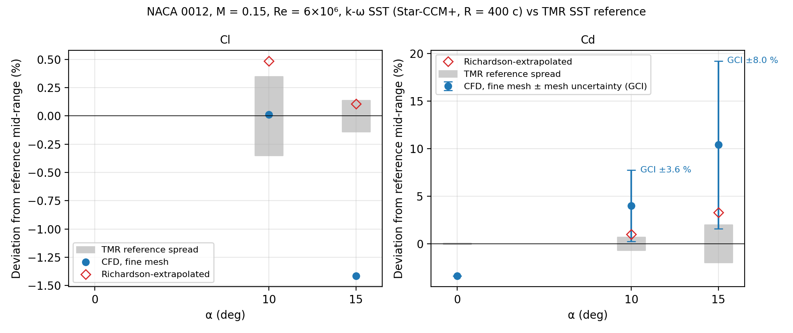
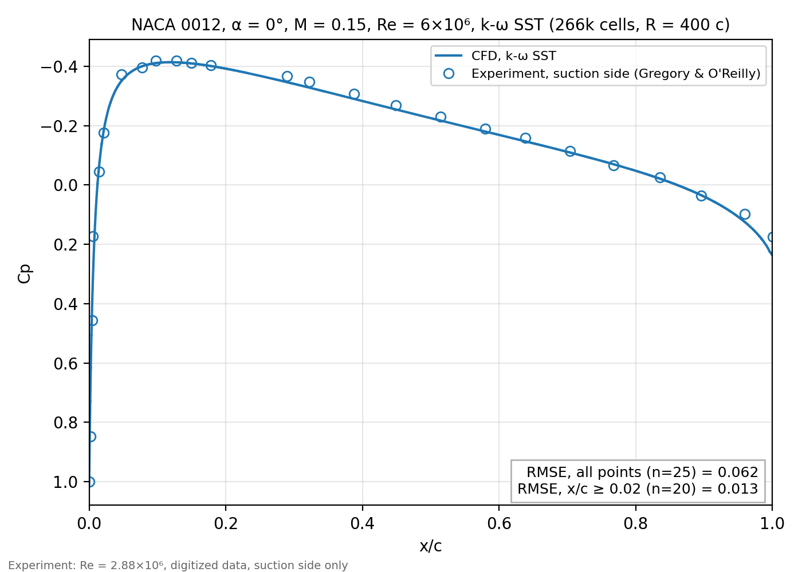
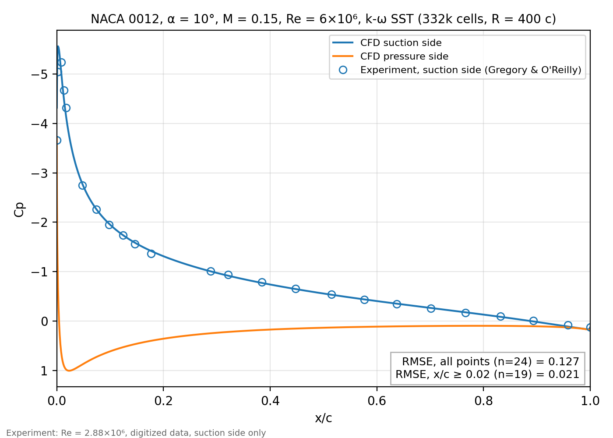
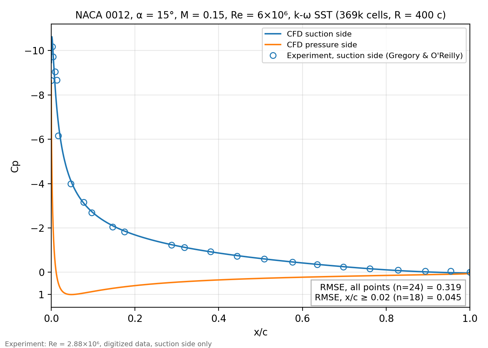

# NACA 0012 airfoil: CFD validation with Star-CCM+

*Stage 1 of a compressor-cascade CFD project (NACA 65-(12)10). Stage 2 is in progress, see the end of this page. [Back to the project overview](../README.md).*

This repository validates a 2D RANS simulation workflow (Simcenter STAR-CCM+, k-ω SST turbulence model) on the NACA 0012 airfoil. This is a standard benchmark with published reference results from NASA's Turbulence Modeling Resource (TMR). The aim is to know how accurate the workflow is, and why, before using it on a compressor cascade.

## Summary

- **Lift is accurate**: Cl is within 1.6 % of the reference at α = 10° and 15° (at 10° it lies inside the spread of the reference codes).
- **Drag is harder**: Cd is 3.4 % below the reference at 0°. At 10° and 15° it is +3 to +5 % and +8 to +13 % above it. After grid-convergence extrapolation the gaps shrink to about +1 % (10°) and +1 to +5 % (15°).
- **The numerical error was measured, not assumed**: enlarging the far-field radius from 50 to 400 chords lowered Cd by about 4 %, and three-mesh studies give an uncertainty (GCI) of 3.6 % at 10° and 8.0 % at 15°.

Flow conditions: Mach 0.15, Reynolds number 6×10⁶ (chord 1 m), angles of attack 0°, 10° and 15°.

## Results at a glance

| α | Cl (CFD) | Cl (reference) | Cd (CFD) | Cd (reference) | Cd error | Cd error after extrapolation |
|---|---|---|---|---|---|---|
| 0° | ≈ 0 | 0 | 0.007809 | 0.00808 – 0.00809 | −3.4 % | – |
| 10° | 1.0804 | 1.0765 – 1.0840 | 0.012941 | 0.01236 – 0.01253 | +3.3 to +4.7 % | +0.3 to +1.7 % |
| 15° | 1.4875 | 1.5068 – 1.5110 | 0.024629 | 0.02187 – 0.02275 | +8.3 to +12.6 % | +1.3 to +5.4 % |

CFD values are from the finest mesh with a 400-chord domain. The reference range is the spread between three established codes (CFL3D, FUN3D, NTS) using the same turbulence model.



*How to read it: the grey band is the spread between the reference codes, the blue dot is this work (fine mesh), the blue bar is the mesh-convergence uncertainty (GCI) of that value, and the red diamond is the value extrapolated to an infinitely fine mesh. The bar is not the same quantity as the "Cd error" range in the table: that range compares the CFD value with the lowest and the highest reference value, whereas the bar is the numerical uncertainty of the CFD value itself, drawn in the same percentage units.*

## Pressure distributions

Pressure coefficient Cp along the chord, compared with wind-tunnel measurements (Gregory & O'Reilly, suction side only, Re = 2.88×10⁶).







| α | RMSE, all points | RMSE, x/c ≥ 0.02 |
|---|---|---|
| 0° | 0.062 | 0.013 |
| 10° | 0.127 | 0.021 |
| 15° | 0.319 | 0.045 |

Two RMSE values are given because the first few measurement points (x/c < 0.02) sit where Cp changes by several units over a few thousandths of a chord, and the digitized data are least reliable there. Away from the leading edge, the RMSE stays below 0.05 at all three angles.

## How the accuracy was established

**1. Wall resolution.** The first mesh layer is sized so that y⁺ stays below 2 everywhere (maximum 0.73, 1.59 and 1.31 at 0°, 10° and 15°).

**2. Far-field size.** The same meshes were run with the outer boundary at 50 and at 400 chords. The larger domain lowers Cd by about 4 % at 10° and 15°, almost entirely through the pressure drag. The effect on Cl is about 0.3 % at most.

| α | Cd, 50 c | Cd, 400 c | Change |
|---|---|---|---|
| 0° | 0.007836 | 0.007809 | −0.35 % |
| 10° | 0.013517 | 0.012941 | −4.3 % |
| 15° | 0.02577 | 0.02463 | −4.4 % |

**3. Mesh convergence.** At 10° and 15°, three meshes were run (coarse, medium, fine). The Grid Convergence Index (GCI, Celik et al. 2008) gives the numerical uncertainty and a Richardson-extrapolated value.

| α | Cells (coarse / medium / fine) | Cd (coarse / medium / fine) | Order p | Extrapolated Cd | GCI (fine mesh) |
|---|---|---|---|---|---|
| 10° | 112k / 195k / 332k | 0.01428 / 0.01336 / 0.01294 | 2.8 | 0.01257 | 3.6 % |
| 15° | 122k / 216k / 369k | 0.03118 / 0.02653 / 0.02463 | 2.9 | 0.02305 | 8.0 % |

Cl is mesh-independent to within 0.6 % at 10° and 1.9 % at 15° (GCI). All results are averages over the last 300 iterations of converged runs. More tables and set-up details are in [`details.md`](details.md).

## Limitations

- At 15°, the flow starts to separate at the trailing edge, where steady RANS is least reliable. The GCI of Cd (8 %, or 13.6 % with a more conservative order p = 2) shows that drag is not fully mesh-converged there.
- The experimental pressures were measured at about half the simulated Reynolds number, and the data are digitized and cover the suction side only.
- The reference forces come from other CFD codes with structured grids and a far field at about 500 chords. The outer boundary here is at 400 chords, and the remaining far-field effect is not quantified.
- The airfoil is the classic NACA 0012 formula closed with a sharp trailing edge at x/c = 1 (maximum thickness 12.0 %). The TMR reference uses a slightly different closure (maximum thickness 11.894 %), a small geometric difference whose effect on Cd was not quantified.
- Only one turbulence model (k-ω SST) was used, without transition modelling.

## Content of this folder

```
README.md         this page
details.md        detailed set-up and result tables
data/             pressure-coefficient exports from Star-CCM+ (Cp_*_R400.csv)
                  and wind-tunnel data (gregory_alpha*.csv)
figures/          all figures shown above
scripts/          Python scripts (Cp plots, GCI calculation, summary figure)
```

The Star-CCM+ simulation files (`.sim`) are not included because of their size.

## Reproducing the figures

Requires Python 3.9 or newer. From the repository root:

```
pip install -r requirements.txt
python 01_naca0012_validation/scripts/make_figures.py
```

The script regenerates every figure in `figures/` and prints the GCI calculation.

## Next step: compressor cascade (in progress)

The validated workflow will be applied to a linear compressor cascade with NACA 65-(12)10 blades, using a periodic domain. The goal is to reproduce the loss and turning versus incidence curves measured in NASA TR-1368, and to compare fully turbulent k-ω SST with a transition model. There are no results yet.

## References

- NASA Turbulence Modeling Resource, "2D NACA 0012 Airfoil Validation Case" (SST results from CFL3D, FUN3D and NTS).
- Gregory, N. and O'Reilly, C. L., "Low-speed aerodynamic characteristics of NACA 0012 aerofoil section, including the effects of upper-surface roughness simulating hoar frost", NASA R&M 3726, 1970.
- Celik, I. B. et al., "Procedure for Estimation and Reporting of Uncertainty Due to Discretization in CFD Applications", J. Fluids Eng. 130(7), 2008.

## Glossary

- **Cl, Cd**: lift and drag coefficients (force divided by dynamic pressure times reference area).
- **Cp**: pressure coefficient, the surface pressure relative to the free stream, divided by dynamic pressure.
- **RANS, k-ω SST**: time-averaged flow equations and the turbulence model used to close them.
- **y⁺**: dimensionless height of the first mesh cell above the wall; values near 1 resolve the boundary layer.
- **GCI**: Grid Convergence Index, an estimate of the numerical error due to the mesh.
- **TMR**: NASA Turbulence Modeling Resource, which publishes verification and validation cases.
- **RMSE**: root-mean-square error between simulation and measurement.
