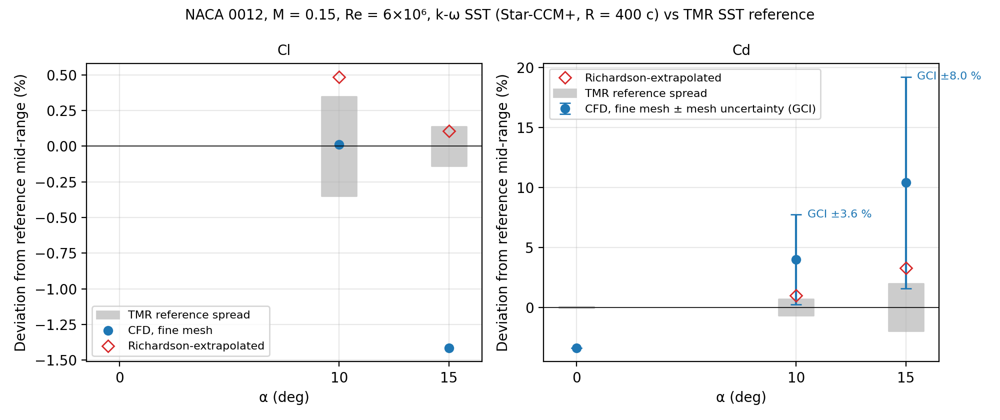

# Compressor cascade CFD: from airfoil validation to a NACA 65-(12)10 cascade

Personal CFD project (Simcenter STAR-CCM+, Python) built in two stages. The first stage validates the simulation workflow on a standard airfoil benchmark, so that its accuracy is known before it is applied to a compressor cascade.

| Stage | Content | Status |
|---|---|---|
| 1 | [NACA 0012 airfoil validation](01_naca0012_validation/) against NASA reference data: Cl, Cd and Cp at 0°, 10° and 15°, far-field study, mesh convergence (GCI) | Done |
| 2 | NACA 65-(12)10 linear compressor cascade (periodic domain), loss and turning versus incidence compared with NASA TR-1368, fully turbulent k-ω SST versus transition model | In progress |

## Stage 1 in one picture

Cl is within 1.6 % of the NASA reference at 10° and 15°, and the drag error is quantified by a far-field study and by mesh-convergence studies. Details, tables and limitations are in the [stage 1 README](01_naca0012_validation/README.md).



## Repository content

```
README.md                      this page
requirements.txt               Python libraries
01_naca0012_validation/        stage 1: README, data, figures, scripts
02_naca65_cascade/             stage 2 (to be added)
```

## Tools

Simcenter STAR-CCM+ 2210 (RANS, k-ω SST), Python (numpy, pandas, matplotlib).

## Author

Lise BARON, IPSA<br>
Contact: <baronlise@hotmail.com>.
